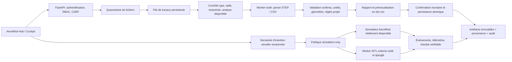

# Cahier des charges — Adaptateur de fichiers STEP/CSV et validation en simulation AeroMind

**Version :** 1.0 — 1er novembre 2026  
**État :** socle v1 implémenté et testé localement, avec limites explicites ; l’acceptation complète exige encore la validation sur PostgreSQL/TiDB, l’intégration d’un antivirus et la qualification d’un moteur SITL externe.  
**Portée :** import/export STEP et CSV, intégration de flux d’ingénierie, demandes de commande exclusivement simulées en simulation interne ou SITL externe.

## 1. Objet et règle de vérité

Ce cahier des charges définit une implémentation testable de l’adaptateur de fichiers AeroMind, de la couche d’orchestration des travaux et de la passerelle de commandes simulées. Il complète le cahier maître AeroMind fourni par le propriétaire du projet. Il ne remplace pas les gates, le RBAC, les contrôles de géofence, les validations indépendantes ni l’audit déjà présents.

La livraison devra distinguer sans ambiguïté :

- un fichier reçu, quarantiné, analysé, validé, enregistré ou rejeté ;
- une configuration présente, une connexion testée et un échange réellement réussi ;
- une démonstration synthétique, un calcul AeroMind réellement exécuté, une simulation SITL observée et un essai physique.

L’interface ne doit pas transformer une intention, une estimation, une réponse synthétique ou une simulation non exécutée en résultat réel. Le projet l’exige déjà pour ses connecteurs et ses runs ; ce cahier étend cette règle au nouveau flux.

## 2. État de référence du dépôt

L’analyse du dépôt en date du cahier des charges a relevé les points suivants :

- Le backend est construit autour de FastAPI, SQLAlchemy et d’un enregistrement central des routers dans `web/app.py`. `python-multipart==0.0.20` figure déjà dans `requirements.txt`.
- `web/engineering_extensions.py` expose notamment une estimation aérodynamique 2D préliminaire et une comparaison énergétique en lecture seule. Ces calculs sont synchrones et ne constituent pas à eux seuls un ordonnanceur de simulations lourdes.
- `web/command_center.py` possède un workflow d’intentions simulées, d’approbations humaines et d’audit. Son exécution actuelle renvoie une confirmation synthétique, avec `physical_output_enabled=false`, sans transport, processus externe ou simulateur de dynamique. Elle ne peut donc pas valider une connexion SITL.
- `web/mavlink_command_api.py` et `web/hardware_gate.py` appartiennent à la voie matérielle réelle. Elle est séparée du centre simulé et comporte notamment un opt-in matériel, une liste de commandes, des tokens unitaires, une géofence et les gates du projet. Le nouvel adaptateur ne doit pas importer cette voie ni l’appeler.
- Aucun endpoint `UploadFile` ou modèle/job dédié aux travaux d’ingénierie n’a été repéré lors de l’audit ciblé. Les noms de fichiers et de routers proposés ci-dessous sont des recommandations, à adapter aux conventions et migrations réellement présentes au moment du développement.

Conséquence : le travail devra ajouter un véritable traitement de fichier asynchrone et une preuve de simulation observable. Il ne devra pas simplement brancher le bouton du Hub sur une valeur par défaut ou sur le centre synthétique existant.

## 3. Périmètre, exclusions et hypothèses

Le périmètre initial couvre :

1. réception, contrôle, prévisualisation, validation, persistance et export contrôlé de STEP et de deux profils CSV versionnés ;
2. provenance des fichiers, rapports de validation, tâches asynchrones, permissions par projet et audit ;
3. demandes de commandes logiques en simulation, en mode interne ou dans un environnement SITL externe explicitement configuré ;
4. le contrat commun des 13 familles de connecteurs du Hub, détaillé dans [le contrat commun des connecteurs AeroMind](CONTRAT_COMMUN_CONNECTEURS_13_FAMILLES_AEROMIND.md).

La première livraison n’inclut pas :

- l’envoi de commandes à un véhicule ou à un contrôleur de vol réel ;
- HITL, essais avec carte de vol réelle, accès série/USB, actionneurs, sortie radio, payload ou mission déployée ;
- l’installation automatique d’un logiciel commercial ou l’achat/demande automatique d’une licence ;
- l’exécution d’un solveur CFD/FEM, d’un logiciel CAD propriétaire ou d’un moteur PLM sans installation, licence et connecteur effectivement testés ;
- le lancement d’un fichier G-code, l’envoi à une machine de fabrication, ni l’exécution de commandes arbitraires provenant d’un fichier ;
- la conversion automatique d’une géométrie STEP en modèle physique SDF/URDF de simulateur. Cette conversion exige un contrat distinct pour les inerties, masses, collisions, articulations, coordonnées et validation physique ; un fichier STEP seul ne suffit pas.

Une capacité absente reste `disabled`, `configuration_required`, `license_required` ou autrement indisponible selon son état réel. Le cahier maître interdit de présenter un connecteur comme opérationnel sans test réel.

## 4. Architecture cible

Le traitement des fichiers et le contrôle simulé partagent l’authentification, le registre de connecteurs, l’ordonnanceur, la provenance, les permissions et l’audit. Ils ne partagent pas le transport matériel.



L’API HTTP ne doit jamais analyser une géométrie volumineuse ou attendre un calcul long dans le thread d’une requête. Elle authentifie, vérifie le contexte, place le fichier en quarantaine, crée une tâche et renvoie son identifiant. Le worker effectue le traitement et publie une progression mesurée, les erreurs et le rapport. Le Hub consulte l’état du serveur ; il n’invente pas la progression.

## 5. Cycle d’import/export et contrat d’API

### 5.1 Import

Endpoint recommandé : `POST /api/engineering/files/import-jobs`, `multipart/form-data`, réponse `202 Accepted`.

Champs obligatoires : fichier, `project_id`, `profile_id`, `dry_run=true` par défaut et `Idempotency-Key` dans l’en-tête. `cell_id` est facultatif mais, s’il est fourni, il doit appartenir au projet autorisé. Le nom de fichier, le type MIME et les champs du CSV sont des entrées non fiables. Un `project_id` absent ou inaccessible doit être refusé ; l’API ne crée jamais de projet ou de cellule par inférence.

Réponse minimale :

```json
{
  "job_id": "uuid",
  "artifact_id": "uuid",
  "status": "queued",
  "phase": "quarantine",
  "progress": null,
  "physical_output_enabled": false
}
```

Un pourcentage ne peut être renseigné que si l’ordonnanceur ou le worker le mesure. Sinon, l’interface affiche une étape textuelle. Une tâche ne passe à `completed` qu’après persistance confirmée et rapport disponible.

### 5.2 Prévisualisation, confirmation et persistance

Le premier traitement est un dry-run : analyse, normalisation proposée, rejets, avertissements, écarts de version, unités reconnues et champs perdus/non gérés. Il ne modifie aucune donnée métier. L’opérateur valide explicitement le rapport et le mappage avant l’étape de commit. Le commit lie le résultat au projet et à la révision attendue, atomiquement ; les conflits de version sont renvoyés comme conflits, jamais résolus par écrasement silencieux.

Un rejeu avec le même `Idempotency-Key` ou le même hash, le même projet et le même profil renvoie le résultat antérieur ou un avertissement de doublon. Il ne crée pas de copies cachées.

### 5.3 Consultation, annulation et export

Endpoints recommandés :

- `GET /api/engineering/jobs/{job_id}` : état autorisé au propriétaire du projet, étapes, statut et dates ;
- `GET /api/engineering/jobs/{job_id}/report` : rapport structuré et erreurs ;
- `POST /api/engineering/jobs/{job_id}/cancel` : annulation si le worker le permet, sinon `cancel_requested` jusqu’à l’arrêt constaté ;
- `POST /api/engineering/files/export-jobs` : export d’un artefact révisé vers un profil autorisé, réponse asynchrone ;
- `GET /api/engineering/artifacts/{artifact_id}/download` : téléchargement authentifié et contrôlé, jamais accès public direct au stockage.

L’export réutilise une révision déterminée et laisse le fichier source immuable. Le rapport d’export identifie le profil, la version de l’exporteur, les unités, les données volontairement écartées et le hash du résultat. Un export tableur « sûr pour ouverture humaine » est distinct du CSV canonique destiné à un autre programme.

### 5.4 Modèles persistants proposés

Utiliser les modèles et conventions de migrations du dépôt. Les entités minimales sont :

- `EngineeringArtifact` : identifiant généré, owner/projet/cellule, nom d’origine nettoyé pour affichage seulement, clé de stockage opaque, taille, hash SHA-256, type détecté, profil, schéma/AP détecté, unités/référence spatiale si applicables, statut, dates, provenance et politique de rétention ;
- `EngineeringJob` : type, artefacts d’entrée, profil/configuration non secrète, statut, phase, progression réelle ou nulle, worker/build, horodatage, erreurs normalisées, rapport, idempotency key et événements de résultat ;
- `ConnectorInstance` : manifeste et état de configuration ; secrets uniquement référencés par identifiant de coffre, jamais enregistrés en clair ;
- `SimulationRun` et `SimulationEvent` : scénario et révision, mode `internal` ou `external_sitl`, cible préconfigurée, intent enuméré, identifiant de run, hash des entrées, versions du simulateur, événements observés, résultat, preuve, audit et valeur explicite `physical_output_enabled=false` ;
- événements d’audit immuables ou append-only selon les services déjà présents.

La persistance ne doit pas dégrader l’isolation existante par utilisateur, projet et cellule. Les fichiers de données ne doivent pas être sérialisés dans des colonnes de session volumineuses.

## 6. Profil STEP

STEP est la famille ISO 10303. ISO 10303-21 définit une méthode d’encodage clair d’une structure d’échange ; AP242 définit un protocole d’application destiné notamment à l’ingénierie 3D gérée, aux structures produit, à la configuration, aux tolérances, à l’inspection et aux données d’analyse. L’extension `.step` ou `.stp` ne prouve pas à elle seule le protocole d’application ni les propriétés conservées par le lecteur [1] [2].

### 6.1 Entrée acceptée

Extensions admises en première version : `.step` et `.stp`, sans se fier à l’extension seule. Le worker détecte le format réellement lu, l’entête, le `FILE_SCHEMA`, le type d’encodage et les versions de schéma annoncées. AP203, AP214 et AP242 ne sont marqués pris en charge que si le parseur et les fixtures AeroMind le démontrent. AP242:2025 est la référence de profil cible ; le fichier est rejeté ou déclassé avec avertissement si le parseur ne le prend pas en charge [2].

La version initiale accepte uniquement le fichier STEP brut dans le profil explicitement testé. Les archives compressées, références distantes et ressources externes sont refusées par défaut. L’import ne suit aucun chemin ou URL inscrit dans le fichier et ne déclenche aucune résolution réseau. Les signatures numériques éventuelles ne sont pas réputées vérifiées tant que leur chaîne de confiance et leur validation cryptographique ne sont pas implémentées.

### 6.2 Résultat normalisé et pertes déclarées

L’import crée un artefact source immuable et, seulement si le parseur le permet, une représentation AeroMind de la géométrie et/ou une dérivée d’affichage. Le rapport inclut : protocole d’application détecté ou inconnu, version du parseur, nombre de produits/occurrences/solides selon capacités, unités, repère, boîte englobante, références externes ignorées, erreurs topologiques, PMI/tolérances/attributs effectivement repris et ceux non repris.

Aucun historique paramétrique, aucune contrainte, aucune tolérance et aucune PMI ne sont revendiqués comme conservés uniquement parce qu’ils figurent dans un STEP. Une géométrie affichable n’équivaut pas à un modèle CAO modifiable ou validé pour fabrication. Les conversions vers mesh sont des dérivés et documentent leur tolérance et leur perte de sémantique.

### 6.3 Export STEP

L’export est produit depuis une révision AeroMind confirmée, via un profil d’export identifié. Le rapport énonce le schéma produit, les unités, l’outil/version, l’éventuelle approximation et les champs non exportés. Une recette de round-trip compare les fixtures d’origine et d’export selon les tolérances propres à chaque fixture. Aucune tolérance géométrique universelle ne peut être déclarée sans accord métier. L’export ne déclenche jamais de fabrication, d’impression 3D ou de commande matérielle.

## 7. Profils CSV

CSV n’a pas une interprétation universelle unique ; RFC 4180 documente un format commun, le média `text/csv`, les séparateurs, guillemets, retours à la ligne et l’échappement des champs. Le cahier n’autorise donc pas une importation métier par simple « détection intelligente » du contenu [3].

### 7.1 Profils v1 autorisés

Seuls ces profils sont acceptés initialement. Le champ `profile_id` est obligatoire et l’utilisateur voit un aperçu des en-têtes et des unités avant commit.

**`aeromind.bom.v1` — nomenclature.** Colonnes canoniques : `part_id`, `revision`, `name`, `quantity`, `quantity_unit`, `material_id`, `unit_mass_kg`, `source_ref`. `part_id`, `revision`, `name` et `quantity` sont requis. `quantity` est numérique et positive ; les unités appartiennent au registre AeroMind versionné. La masse est facultative et, lorsqu’elle est fournie, est exprimée en kg. Les références du projet et de la cellule proviennent du contexte autorisé du formulaire/API, et non d’une valeur CSV qui pourrait détourner le rattachement.

**`aeromind.simulation-results.v1` — résultats/tabulaire de simulation.** Colonnes canoniques : `run_id`, `timestamp_utc`, `signal`, `value`, `unit`, `frame`, `quality_flag`, `source`. Le run doit exister ou être explicitement enregistré comme import externe ; timestamps sont ISO 8601 en UTC ; `signal`, `unit`, `frame` et qualité sont validés contre les vocabulaires versionnés. Les colonnes spatiales exigent un repère explicite. Un CSV de mesures importé n’est pas une mesure AeroMind acquise en direct.

Les CSV de commandes, missions ou paramètres d’actionneur ne sont pas pris en charge. Le lecteur n’exécute pas de formule, de commande ou de macro. Un champ ressemblant à une instruction reste une chaîne inerte ou entraîne le rejet du mapping si l’interface tente de le lier à une capacité de commande.

### 7.2 Dialecte et validation

Le dialecte de base est UTF-8, en-tête obligatoire, virgule, règles de citation et d’échappement RFC 4180. Toute variante (BOM UTF-8, séparateur point-virgule, convention décimale locale) doit être sélectionnée explicitement et figurer dans le rapport ; le backend n’infère pas silencieusement le séparateur, le séparateur décimal, le repère ou une unité. L’encodage invalide, les colonnes dupliquées, les nombres non finis, les lignes irrégulières, les unités inconnues et les identifiants ambigus sont signalés et soumis aux règles de rejet du profil.

### 7.3 Défense contre l’injection de formules

Les cellules CSV peuvent être interprétées comme formules par des tableurs, notamment lorsqu’elles commencent par `=`, `+`, `-`, `@`, tabulation ou certains caractères de contrôle. OWASP avertit également qu’un simple quoting ne constitue pas une mitigation universelle et que certaines neutralisations modifient les données sous-jacentes [4].

AeroMind doit fournir deux produits distincts :

- `machine-canonical` : CSV réimportable, strictement échappé selon le dialecte déclaré ; pas de transformation de contenu cachée ; les champs restent des données, jamais du code ;
- `spreadsheet-safe` : export d’affichage humain appliquant une neutralisation documentée à chaque cellule à risque et ajoutant un avertissement dans le rapport. La technique retenue est testée contre les tableurs ciblés, et la modification (par exemple préfixe de tabulation) est signalée. Ce fichier n’est pas réimportable comme donnée canonique sans étape explicite de retraitement.

Aucun export n’est annoncé universellement sûr pour tous les tableurs ou consommateurs ; OWASP relève qu’il n’existe pas de stratégie d’assainissement universelle [4].

## 8. Sécurité de fichiers et des connecteurs

Appliquer une défense en profondeur conforme à OWASP : extensions autorisées limitées au besoin, vérification du contenu et de la signature lorsque possible, nom de stockage généré par AeroMind, limite de taille, autorisation par utilisateur/projet, stockage hors racine web, analyse antivirus/sandbox si disponible, protection CSRF et bibliothèques maintenues. Le `Content-Type` fourni par le navigateur n’est qu’un indice et ne fait pas foi [5].

### 8.1 Quarantaine et isolation

Le téléversement est écrit sous un identifiant opaque dans un espace de quarantaine. Le chemin disque n’est jamais composé à partir d’un nom d’utilisateur, d’un chemin ou d’une extension fournis. Le navigateur ne peut pas récupérer le fichier avant autorisation et validation.

Le parser STEP et les futurs parseurs CAO sont exécutés hors processus web, sans privilèges, sur un système de fichiers temporaire, avec limites CPU/RAM/durée, nombre de fichiers, processus et espace de stockage. Sortie réseau désactivée par défaut. Nettoyage garanti après réussite, échec ou annulation. Les limites doivent être configurables et testées sur l’infrastructure de déploiement avant annonce de capacité.

Valeurs de départ recommandées pour le profil de recette, non garantie de capacité en production : STEP 250 MiB ; CSV 50 MiB, 500 000 lignes et 256 colonnes ; parsing au plus 10 minutes et 4 GiB de RAM par travail ; au plus deux imports concurrents par projet. Tout ajustement en production exige un test de charge et des limites de quota équivalentes.

Si l’analyse antivirus n’est pas installée, le rapport indique `not_scanned`. Quand la politique du déploiement rend le scan obligatoire, l’absence du scanner garde le fichier en quarantaine et bloque le commit. « Parser sans erreur » n’équivaut pas à « fichier sûr ».

### 8.2 Authentification, secrets, réseau et journaux

Chaque endpoint de modification exige la session et la protection CSRF prévues par AeroMind, le RBAC serveur et la vérification de propriété du projet et des artefacts. Aucun filtrage de permissions n’est confié au seul frontend.

Les secrets d’un connecteur externe sont stockés dans un coffre, fournis au worker par référence temporaire et exclus des traces, exceptions, rapports, états React et valeurs de configuration retournées par l’API. Les endpoints réseau sont préconfigurés et en liste d’autorisation ; aucune URL libre fournie par un utilisateur ne peut transformer le worker en client SSRF. Les journaux retiennent identifiants, empreintes, dates, acteur, versions, statut et code d’erreur, pas le fichier complet, les tokens ni les secrets.

Les chemins commerciaux ne sont activés qu’après confirmation du produit/version, des droits d’usage, de la licence et de l’environnement autorisé. Aucun logiciel propriétaire n’est installé automatiquement.

## 9. Commandes sous contrôle en simulation interne/externe

### 9.1 Invariant matériel

`HARDWARE_CONTROL` reste désactivé par défaut. Cette livraison n’étend ni l’allowlist de commandes matérielles, ni les tokens physiques, ni les gates G0–G5, ni la géofence, ni le contrôle de mission. Le nouvel adaptateur ne doit jamais importer ou invoquer `web.mavlink_command_api`, `web.hardware_api` ou un transport matériel. Les commandes physiques et tout test sur véhicule sont hors périmètre.

Le worker SITL est un processus distinct, non privilégié, dont la configuration force `HARDWARE_CONTROL=false`, ne monte aucun port série/USB ou périphérique de sortie, et ne peut joindre qu’un endpoint de simulation préconfiguré. Une valeur fournie par le client ne permet ni de changer de mode ni de cibler un véhicule. Une instance externe sans attestation d’environnement SITL connue ne reçoit aucune commande.

SITL et HITL ne sont pas interchangeables : les guides PX4 distinguent le logiciel exécuté dans un simulateur d’une configuration HITL qui utilise un contrôleur de vol réel ; l’architecture SITL peut être interne ou liée à des simulateurs externes. Le périmètre initial autorise SITL isolé uniquement, jamais HITL [6]. ArduPilot décrit aussi SITL comme une exécution du firmware sans matériel, alimentée par un modèle de dynamique de vol [7].

### 9.2 Intentions simulées

Les commandes sont des intentions typées, liées à un scénario et à une révision ; aucun CSV ni texte libre n’est compilé en commande. Le premier profil reprend les commandes logiques déclarées par le centre simulé AeroMind : pause, maintien, retour simulé et atterrissage simulé. Leur traduction vers une API propre au simulateur est définie par chaque adaptateur SITL et demeure dans l’environnement simulé. Les paramètres, transitions autorisées et retours observables sont versionnés avec le profil de scénario.

La demande comporte au minimum `simulation_mode`, `scenario_id`, `scenario_revision`, `command_intent`, `project_id`, `actor_id`, `request_hash`, `idempotency_key` et `simulation_target_id` préconfiguré. Un changement d’intent ou de paramètre après approbation invalide la demande et impose un nouveau cycle. Toute valeur inconnue, cible libre, mode `physical` ou paramètres hors schéma sont rejetés côté serveur.

La revue humaine à deux identités distinctes du Centre de commandes peut encadrer l’approbation. Cette approbation n’est ni une preuve de simulation ni une autorisation matérielle. La réponse synthétique actuelle (`synthetic_acknowledgement`, `evidence_level=synthetic_demo`) ne compte pas comme exécution SITL.

### 9.3 Simulation interne AeroMind

Le mode interne utilise un moteur AeroMind identifié, versionné et testable. Avant implémentation, l’équipe confirme quel moteur actuel fournit la simulation de dynamique, ses entrées et ses sorties. Les estimations conceptuelles de `engineering_extensions.py` ne sont pas qualifiées de dynamique de vol.

Si aucun moteur interne adéquat n’est disponible, un harness déterministe peut servir aux tests de flux. Il porte obligatoirement le label `synthetic_demo` ou `workflow_test`; il ne se déclare ni modèle physique ni validation d’ingénierie. L’interface doit afficher la nature exacte du résultat.

### 9.4 Simulation externe SITL

Chaque moteur SITL est une instance préconfigurée et identifiée (produit, version, build/image digest, configuration, protocole, cible réseau dédiée). Aucun endpoint UDP/TCP, nom d’image ou argument de processus arbitraire n’est accepté depuis le navigateur. Le lancement ou l’arrêt est géré par le superviseur de jobs, avec délais, ressources, kill de groupe de processus, journaux expurgés et résultat conservé.

La réussite d’un travail exige une réponse observable du processus SITL attendu et une télémétrie ou transition d’état conforme au scénario. Le statut n’est pas réussi parce que le processus a démarré, qu’une connexion TCP s’est ouverte, ou qu’une chaîne « ACK » synthétique a été produite. Si le fournisseur de simulation ou la licence est indisponible, l’état reste indisponible/configuration/licence requise ; le Hub ne simule pas la disponibilité.

Les ports et protocoles sont propres à chaque profil et vérifiés sur le simulateur/version configuré. La documentation PX4 distingue notamment le simulateur interne SIH, Gazebo via `gz_bridge` et des simulateurs communiquant via l’API MAVLink ; ces chemins ne doivent pas être mélangés ni présumés interchangeables [6].

### 9.5 Garanties de non-émission physique

À chaque job simulé, le stockage et les réponses exposent `mode=simulation_internal|simulation_external`, `physical_output_enabled=false`, `sent_to_hardware=false`, `target_kind=simulator`, `evidence_level` exact et références des événements observés. Ce ne sont pas des cases déclaratives suffisantes : les tests confirment aussi que la route matérielle n’est jamais atteinte, qu’aucun dispositif physique n’est monté et que le réseau ne permet pas de sortir de la zone de test.

Si l’isolement ne peut pas être démontré, l’adaptateur n’exécute pas la commande et renvoie `SIMULATION_ISOLATION_UNVERIFIED`. L’arrêt ou l’annulation d’un job ne se transforme jamais en commande de véhicule réel.

## 10. Contrat des connecteurs et contrats de résultat

Le connecteur STEP/CSV est la première instance du contrat commun décrit dans [le contrat AeroMind des 13 familles](CONTRAT_COMMUN_CONNECTEURS_13_FAMILLES_AEROMIND.md). Il doit exposer des capacités étroites et versionnées plutôt qu’un champ générique « supporte tout ».

Opérations minimales : `describe`, `health_check_read_only`, `validate_input`, `import_dry_run`, `commit_import`, `export`, `cancel_job` si possible et `get_report`. `health_check_read_only` ne modifie aucun fichier, projet, licence ou état du moteur. Pour les connecteurs de calcul, la capacité `run_simulation` est distincte de l’état d’import/export.

État d’une instance (codes machine conformes au cahier maître) : `available`, `connected`, `disconnected`, `configuration_required`, `license_required`, `error`, `disabled`. Une instance ne passe à `connected` qu’après une vérification réelle réussie du binaire/API et un échange de test non destructif attesté ; le rapport contient date, version, capacités testées et résultat. Le test périmé ou échoué met à jour l’état. Une famille peut être partiellement disponible : chaque capacité garde son propre résultat de test.

Chaque `JobReport` contient au minimum :

```json
{
  "schema_version": "aeromind.job-report.v1",
  "job_id": "uuid",
  "project_id": "uuid",
  "artifact_ids": [],
  "profile_id": "aeromind.bom.v1",
  "profile_version": "1.0.0",
  "status": "succeeded_with_warnings",
  "evidence_level": "parsed_and_validated",
  "input_sha256": "…",
  "worker_version": "…",
  "tool_versions": {},
  "unit_conversions": [],
  "accepted_records": 0,
  "rejected_records": 0,
  "warnings": [],
  "errors": [],
  "created_at": "ISO-8601 UTC",
  "physical_output_enabled": false
}
```

Aucune donnée `evidence_level` ne peut être élevée du seul fait qu’une étape précédente a réussi. La provenance doit permettre de retrouver l’entrée, la révision, les transformations, le parseur, le worker et les sources externes.

## 11. Séquence de réalisation

**Phase 0 — audit d’implémentation.** Confirmer les migrations et modèles, le stockage et sa rétention, les routes CSRF/RBAC, les gates, le mécanisme de worker déployé et la version supportée des parseurs. Rédiger le manifeste des capabilities et les fixtures licenciées/redistribuables. Pas de modification matérielle.

**Phase 1 — import CSV.** Implémenter `aeromind.bom.v1` et `aeromind.simulation-results.v1`, l’upload en quarantaine, le dry-run, le commit explicite, l’audit et l’export séparé machine/tableur. Tester les utilisateurs et les projets isolés.

**Phase 2 — import/export STEP.** Intégrer un parseur maintenu dans un worker isolé. Supporter uniquement les profils démontrés par les fixtures. Publier matrice de capacités géométriques et pertes. Ajouter l’export et le round-trip avant d’annoncer une capacité export.

**Phase 3 — commandes en simulation interne.** Réutiliser le moteur AeroMind réellement qualifié ou mettre en place un harness marqué synthétique. Relier demandes, identités d’approbation, runs et événements sans transport matériel.

**Phase 4 — SITL externe isolé.** Ajouter un profil par moteur et version approuvés, verrouillage d’environnement, health-check non destructif, run réel et rapport attesté. Commencer par un seul SITL et un seul scénario en CI dédiée.

**Phase 5 — autres familles.** Ajouter progressivement CAD, FEM/CFD, CAO électronique, outils logiciels et PLM à partir du contrat commun, sans élargir le périmètre à toutes les applications dans un même lot. Les profils et gates sont définis dans le document contractuel complémentaire.

Chaque phase est livrée et testée avant le commencement du lot suivant. Un moteur absent ne bloque pas l’API commune ou les autres profils.

## 12. Plan de validation et critères d’acceptation

Un test est `PASS` uniquement après exécution par le code correspondant. L’absence de binaire SITL, de licence ou de service marque le test externe `BLOCKED` ou `NOT RUN`, jamais `PASS`.

### Import et intégrité

- **FILE-01** : utilisateur non authentifié, projet non possédé et cellule d’un autre projet sont refusés côté serveur ; aucun fichier ou job métier orphelin n’est créé.
- **FILE-02** : nom `../../x.step`, double extension, nom très long, caractères de contrôle et MIME falsifié ne permettent ni traversal ni écrasement ; stockage par identifiant généré.
- **FILE-03** : tailles supérieures au plafond, fichier vide, quota projet dépassé et limites de concurrence sont refusés avec état et erreur stables.
- **FILE-04** : hash d’entrée, idempotence, absence de commit automatique et nettoyage des fichiers temporaires sont vérifiés.
- **FILE-05** : stockage non public, téléchargement authentifié, CSRF, `nosniff` et absence de secrets dans logs/rapports sont testés.
- **STEP-01** : jeux de tests valides et invalides couvrent Part 21, au moins les profils réellement déclarés supportés, unités, repères, géométrie vide/corrompue, références externes et fichier surdimensionné.
- **STEP-02** : un AP ou champ non supporté produit rejet ou avertissement précis ; aucune propriété PMI, tolérance ou historique n’est faussement revendiquée.
- **STEP-03** : une référence externe ne provoque pas d’accès réseau ou fichier ; le worker est borné et arrêté à l’expiration.
- **STEP-04** : exports testés contre des fixtures contrôlées ; hash du fichier source inchangé ; rapport de pertes et tolérance de comparaison conservés.
- **CSV-01** : tests RFC 4180 vérifient guillemets, virgules, sauts de ligne, guillemets doublés, header, champs irréguliers et encodages autorisés.
- **CSV-02** : profils BOM et résultats testent colonnes manquantes/extra, nombres non finis, unités, dates et repères ; le séparateur ou unité n’est jamais deviné silencieusement.
- **CSV-03** : chaînes de test commençant par `=`, `+`, `-`, `@`, tab, CR/LF ou variantes Unicode restent inertes à l’import ; exports `machine-canonical` et `spreadsheet-safe` sont distincts et documentés.
- **CSV-04** : taille, nombre de lignes/colonnes, encodage erroné, duplication, ordre différent et données contradictoires avec le projet déclenchent avertissement ou rejet selon le profil.

### Simulation et commande

- **SIM-01** : chaque run indique son mode et la cible testée, garde `physical_output_enabled=false` et ne dépend pas d’une valeur envoyée par l’utilisateur.
- **SIM-02** : le test de commandes d’un run interne obtient un résultat de moteur ou porte explicitement le niveau `workflow_test`/`synthetic_demo`; une réponse synthétique ne peut pas être marquée SITL.
- **SIM-03** : test SITL externe épingle image/build et version ; commande permise n’est exécutée que sur une instance de simulation provisionnée et observée ; l’absence du moteur produit `NOT RUN`.
- **SIM-04** : test négatif appelle l’adaptateur sous environnement worker avec un faux transport matériel et prouve qu’aucune fonction/routes matérielles n’est appelée ; aucun port série/USB n’est monté.
- **SIM-05** : réseau simulé refuse les destinations hors liste d’autorisation ; les commandes basées sur fichier/URL ou noms de commande inconnus sont rejetées.
- **SIM-06** : réponse, journaux et état persistent après redémarrage du worker ; timeout, annulation, processus zombie, réexécution idempotente et erreurs du simulateur sont vérifiés.
- **SIM-07** : la voie de simulation ne change pas `HARDWARE_CONTROL`, l’allowlist matérielle, les tokens, gates G0–G5 ni le résultat des tests de contrôle existants.
- **E2E-01** : import STEP en dry-run, import BOM CSV, approbation et commit associent les fichiers à la bonne révision de projet, avec rapport consultable et audit.
- **E2E-02** : la simulation interne et une instance SITL dédiée produisent chacune des événements liés au même contexte de projet, mais la recette n’affirme pas que la géométrie STEP pilote la dynamique tant qu’un traducteur STEP→modèle simulateur distinct n’est pas validé.
- **CONN-01** : le Hub expose l’état serveur réel, le test de santé non destructif, la dernière preuve d’échange, les capacités précises et l’erreur ; aucune carte ne se déclare connectée à partir d’un simple formulaire.

### Qualité de livraison

La livraison d’un lot doit inclure migrations, documentation d’installation et de configuration, exemples non confidentiels, tests unitaires/API/worker/E2E, rapports de recette, versions de parseurs et connecteurs vérifiées, limites non supportées, capture de l’état réel et liste de connecteurs bloqués par licence. Les tests frontend et backend pertinents, le contrôle de types et le build doivent passer. Les tests d’un moteur externe sont marqués bloqués lorsque son environnement réel manque.

## 13. Questions d’entrée avant l’implémentation

Ces éléments n’empêchent pas d’écrire le code de base, mais doivent être décidés avant l’activation en production : lieu du worker (serveur, VM ou hôte client) ; stockage et règles de rétention ; moteur STEP et capacités AP242/PMI réellement accessibles ; limites de taille compatibles avec l’infrastructure ; simulateur externe prioritaire (PX4 SITL ou ArduPilot SITL), image/version et licence ; disponibilité d’un moteur AeroMind interne qui produit une dynamique réelle ; politiques de revue humaine et profils CSV exigés par les premiers utilisateurs.

Les valeurs par défaut restent fermées : import en dry-run, connecteur non connecté, scan non prétendu, commande physique désactivée, simulateur absent déclaré indisponible.

## Références

[1]: https://www.iso.org/standard/63141.html "ISO 10303-21:2016 Clear text encoding of the exchange structure"
[2]: https://www.iso.org/standard/84300.html "ISO 10303-242:2025 Managed model-based 3D engineering"
[3]: https://www.rfc-editor.org/info/rfc4180/ "RFC 4180 Common Format and MIME Type for CSV Files"
[4]: https://owasp.org/www-community/attacks/CSV_Injection "OWASP CSV Injection"
[5]: https://cheatsheetseries.owasp.org/cheatsheets/File_Upload_Cheat_Sheet.html "OWASP File Upload Cheat Sheet"
[6]: https://docs.px4.io/main/en/simulation/ "PX4 Simulation"
[7]: https://ardupilot.org/dev/docs/sitl-simulator-software-in-the-loop.html "ArduPilot SITL Simulator"


## 14. État d’exécution et limites de la version 1 — 1er novembre 2026

### Livré dans le dépôt
- API FastAPI `/api/engineering` pour le catalogue serveur, l’état de simulation, les imports, l’inspection de jobs/rapports, le commit explicite, l’annulation, l’export et les téléchargements propriétaires.
- Profils CSV AeroMind BOM et résultats de simulation, choix explicite de dialecte, validation/normalisation en JSONL, rapport de lignes acceptées/rejetées et export machine ou tableur-sûr.
- Profil STEP Part 21 pour contrôles structurels et identification AP203/AP214/AP242. **Aucune géométrie STEP n’est extraite ou injectée dans le jumeau.**
- Modèles SQLAlchemy et migrations additives PostgreSQL/TiDB pour artefacts, jobs et runs internes ; liaison optionnelle à une cellule `cell_id` ; clés d’idempotence et événements d’audit.
- Worker distinct Compose avec volume partagé, utilisateur non privilégié, réseau interne dédié, sans périphérique déclaré ni réseau sortant ; la configuration Render garde le traitement de fichier désactivé tant que le worker et le stockage durable ne sont pas provisionnés.
- Simulation interne idempotente marquée `educational_model`, avec `physical_output_enabled=false`. La route SITL externe répond `not_run`/HTTP 409 tant qu’aucun runner isolé n’est qualifié ; elle ne lance pas PX4/ArduPilot et n’émet aucune commande physique.
- Panneau Hub relié à l’API ; registre honnête des 13 familles. L’interface affiche le refus d’authentification au lieu de fabriquer un état « connecté ».

### Ce que le commit signifie réellement
Le commit lie au projet l’artefact validé et son rapport/version normalisée. Il **ne peuple pas encore** les entités métier BOM, exigences, mesures ou géométrie du projet. Un adaptateur de conversion vers ces modèles métier reste à développer avec une validation utilisateur et des règles de mapping propres à chaque profil.

### Conditions restant à lever pour l’acceptation complète
1. Appliquer et tester les deux migrations sur des bases PostgreSQL et TiDB réelles avec sauvegarde et stratégie de retour arrière approuvée.
2. Ajouter un antivirus/quarantaine intégrée ; si `AEROMIND_ENGINEERING_REQUIRE_AV_SCAN=true`, le flux bloque actuellement le commit faute de verdict `clean`.
3. Qualifier un parseur STEP réel et des exemples AP242/PMI, puis distinguer inspection structurelle et conversion géométrique.
4. Choisir, isoler et tester un runner PX4 SITL ou ArduPilot SITL. L’exécution externe demeure intentionnellement indisponible.
5. Implémenter les mappings vers les tables métier et les tests d’intégration UI/API authentifiés avec un projet et une cellule réels.
6. Provisionner le worker et un volume partagé durable avant toute activation en production. Aucun connecteur CAD/CAO/CFD/PLM propriétaire n’est inclus dans ce lot.

### Résultats de validation
Les 14 tests dédiés du nouvel adaptateur/API/migrations passent. Le frontend passe `pnpm check`, 336 tests Vitest (70 fichiers) et `pnpm build`; le build émet seulement un avertissement sur des chunks volumineux. Le compose et `render.yaml` passent le parsing YAML et les assertions statiques d’isolation. Sur une suite backend plus large, 85 tests passent et 2 sont ignorés, mais 7 échouent : trois tests d’une migration canonique contenant `CREATE OR REPLACE FUNCTION` sous l’adaptateur SQLite, trois tests de commandes `NAV_TAKEOFF` sans position (`p5/p6`) ni provider conformément au garde-fou, et un test de cache de géofence. Ces échecs empêchent de déclarer la suite globale verte. Aucune base PostgreSQL/TiDB, aucun scanner, aucun moteur externe ni aucun matériel n’a été exercé.
