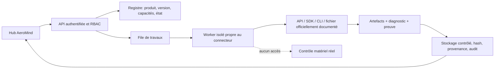

# Contrat commun d’intégration des 13 familles de connecteurs AeroMind

**Version :** 1.0 — 1er novembre 2026  
**État :** contrat de référence et registre serveur des 13 familles livrés ; aucun adaptateur CAD/CAO/CFD/PLM externe n’est déclaré installé, licencié, configuré, connecté ou validé en direct.  
**Périmètre source :** les 13 entrées affichées par `frontend/client/src/modules/engineering-hub/EngineeringHub.tsx`.

Ce contrat complète le [cahier des charges de l’adaptateur STEP/CSV et des simulations AeroMind](CAHIER_DES_CHARGES_ADAPTATEUR_STEP_CSV_SIMULATION_AEROMIND.md). Il définit comment introduire des connecteurs CAD/CAO, calcul, simulation, fabrication et PLM sans transformer le registre du Hub en catalogue de capacités non prouvées.

## 1. Règle centrale : une famille n’est pas une capacité vérifiée

Une ligne du Hub peut agréger plusieurs outils commerciaux et open source. Chacun peut avoir sa propre API, son mode d’exécution, sa compatibilité, ses licences, ses formats, son installation et ses limitations. Le connecteur est donc enregistré et vérifié par **produit, édition/version, build, mode d’intégration et capacité**, jamais par seul nom de famille.

La recherche documentaire réalisée pour cette spécification a vérifié des sources officielles pour les familles 1 à 7. Elle n’a pas produit de dossier de sources vérifiables pour les familles 8 à 13. Pour ces six familles, le contrat précise des garde-fous et des travaux de qualification obligatoires ; il n’affirme pas quel endpoint, CLI, format ou SDK elles exposent. Le profil demeure `source_validation_pending` et ne peut être annoncé `connected` ou pris en charge tant que la vérification source et les essais sur une version réellement disponible ne sont pas terminés.

Même pour les sept familles documentées, la recherche porte sur les interfaces publiquement documentées, pas sur un environnement AeroMind. Aucun outil, licence, endpoint, runtime ou échange live n’a été testé dans cette spécification.

## 2. Architecture commune

Tous les adaptateurs sont des workers ou services spécialisés, derrière une API AeroMind authentifiée. Un profil ne fait jamais exécuter du code utilisateur directement dans le serveur web. Le contrat distingue quatre surfaces :

1. **Données et fichiers** : formats d’entrée/sortie explicites, manifeste de fichiers, tailles et empreintes.
2. **Calcul/exécution** : API ou processus autorisé, options versionnées et limites de ressources.
3. **État et résultat** : progression observée, diagnostic, artefacts, versions et niveau de preuve.
4. **Sécurité** : secret externe, permissions, limites réseau, environnement sandbox, approbation de toute écriture.



Aucun connecteur de calcul ne partage les tokens, ports série, périphériques, environnement ou worker du contrôle physique. Les profils PX4/Gazebo et autres exécutions de véhicule restent SITL et isolés uniquement ; le contrat n’autorise ni véhicule réel, ni HITL, ni émission physique.

## 3. Manifeste normalisé

Chaque instance enregistrée expose un manifeste versionné équivalent au schéma conceptuel ci-dessous. Les champs secrets contiennent des **références** vers le coffre, jamais une valeur confidentielle.

```json
{
  "schema_version": "aeromind.connector-manifest.v1",
  "connector_id": "uuid",
  "family_id": "cad-mechanical",
  "product": "nom officiel du produit",
  "edition": "édition/licence si vérifiable",
  "product_version": "version exacte",
  "build_id": "build / service pack / digest",
  "integration_mode": "file|sdk|in_process|subprocess|grpc|http",
  "executable_id": "référence allowlistée ou null",
  "endpoint_id": "référence préconfigurée ou null",
  "capabilities": ["file.step.import"],
  "format_profiles": ["step.ap242.read"],
  "license_state": "unknown",
  "source_validation": "verified|pending",
  "health_checked_at": null,
  "last_exchange_test": null,
  "status": "configuration_required",
  "evidence_level": "not_tested"
}
```

L’`integration_mode` indique le mécanisme effectivement validé. Le fait qu’un éditeur documente une API ne signifie ni qu’elle est disponible avec la licence déployée, ni qu’AeroMind sait l’appeler. La capacité est déclarée séparément et testée individuellement. Si la licence n’inclut pas une fonction, seule cette capacité est indisponible ; la famille ne doit pas simuler une réussite globale.

### États et transitions

Les codes persistés restent conformes au cahier maître AeroMind : `available`, `connected`, `disconnected`, `configuration_required`, `license_required`, `error`, `disabled`. L’UI peut traduire ces codes, mais ne les déduit pas d’une simple saisie de configuration.

- `available` : profil logiciel décrit, instance non configurée.
- `configuration_required` : information/installation/endpoint nécessaire manque.
- `license_required` : produit ou capacité exige une licence/entitlement non confirmé.
- `connected` : contrôle réel récent, version reconnue, licence/capacité disponible si nécessaire, échange de test non destructif réussi et rapport persistant.
- `disconnected` : l’instance précédemment fonctionnelle n’est plus joignable ou le service est arrêté.
- `error` : l’instance répond, mais la version, la configuration, le protocole ou un test requis échoue ; diagnostic expurgé disponible.
- `disabled` : désactivé par politique, sans appel externe.

Un état de famille, un état de licence et l’état de chaque capability restent séparés. L’état peut devenir périmé ; le Hub doit afficher la date du dernier test et les capacités incluses dans la preuve. L’API ne renvoie pas de secret, même à un Super Admin.

## 4. Contrat API des opérations et des artefacts

Les noms ci-dessous représentent le contrat backend recommandé ; ils n’impliquent aucun endpoint fournisseur. Les adaptateurs implémentent une interface AeroMind interne :

- `describe()` renvoie manifeste, capabilities, prérequis, versions supportées et limitations ;
- `health_check_read_only()` confirme uniquement les prérequis effectivement testés, sans modification de fichier ou de projet ;
- `validate_input()` inspecte le manifeste, les extensions, le schéma, les unités, les versions et les limites avant exécution ;
- `dry_run()` calcule le plan et les transformations sans écriture externe ni commit AeroMind ;
- `execute()` lance une opération allowlistée et versionnée, uniquement après droits suffisants ;
- `collect_result()` valide sorties attendues, empreintes, états et diagnostics ;
- `cancel()` demande l’arrêt et rapporte le moment où l’arrêt est constaté ;
- `export()` est une capacité distincte, non présumée quand l’import fonctionne.

Les opérations d’écriture vers une source externe sont désactivées au démarrage. Leur activation nécessite un profil de capacité spécifique, l’approbation de l’utilisateur autorisé, un aperçu des changements, une clé d’idempotence et une piste d’audit. La synchronisation destructive, le « publish », le check-in/release, l’effacement et la fabrication sont hors du contrat par défaut.

Un `ConnectorJob` contient `job_id`, `project_id`, `actor_id`, `connector_id`, `capability`, `idempotency_key`, hashes d’entrées, révision de projet, versions, statut/phases, progression mesurée, options normalisées non secrètes, résultat/erreurs, rapport et dates. Les artefacts portent le système source, l’identifiant externe, la révision, le hash, le format/profil, les unités, le repère, les conversions, la version du parseur et la provenance. Aucun système externe ne peut écraser un artefact AeroMind sans comparaison de révision et validation.

### Sous-processus, API et licences

Chaque API ou mode de lancement est couvert par une recette propre au produit et à la version. Pour un CLI, l’exécutable vient d’une allowlist administrée ; arguments passés en tableau, jamais assemblés en commande shell ; répertoires temporaires par job ; limites CPU/RAM/durée ; journalisation expurgée ; terminaison de l’arbre de processus. Aucun script fourni par un utilisateur n’est lancé avec des privilèges.

Pour HTTP/gRPC, le serveur est préconfiguré, TLS vérifié, hôte limité par allowlist, délais et tailles plafonnés, certificat/jeton gérés comme secret. Le navigateur ne fournit pas d’URL à appeler. Les tâches de calcul peuvent manipuler des données de conception propriétaires : réseau sortant fermé par défaut et ouvert seulement aux services nécessaires.

Avant activation, documenter le logiciel exact, l’entitlement, la version d’API, le système d’exploitation, runtime, prerequis, éventuel serveur de licence, conditions de déploiement et politique de redistributions des scripts/outils. L’absence d’une licence ou d’une version testée ne se contourne pas par repli silencieux.

## 5. Profils des 13 familles du Hub

### 01 — FreeCAD : CAO paramétrique / FEM

**Interfaces documentées.** Le projet FreeCAD documente une API C++ et Python, le scripting/macros, l’interpréteur embarqué et les modes console/ligne de commande. C’est une application ou un processus local, pas une API web indépendante. La configuration CLI est sensible à la version ; le contrat interroge le binaire cible et découvre les workbenches/importers/exporters disponibles [1] [2].

**Données.** `.FCStd` est le document natif. La documentation énumère séparément les opérations d’import/ouverture et export/création pour les formats d’échange ; STEP/STP, IGES, mesh, DXF/IFC et autres ne sont activés que si le build et l’atelier installés confirment la direction et le test. Un round-trip neutral ne promet pas l’historique paramétrique [3].

**Gates.** Pin du build/OS, configuration/workbenches, API, tolérances, repère et unités ; répertoire de job isolé ; test headless et save/reopen sur fixture. La page officielle de licence était inaccessible lors de cette revue ; le contrat ne fige donc pas de conclusion juridique. Vérifier le fichier de licence du build et les licences de ses dépendances avant redistribution [4]. Le contrat ne présume ni installation, ni interface réseau, ni compatibilité réelle avec le dépôt.

### 02 — OpenVSP : aérodynamique / géométrie

**Interfaces documentées.** API C++, module Python `openvsp`, scripting AngelScript et exécutable `vspscript`. La configuration de l’API décrit des modes graphiques/non graphiques et une façade séparée par sockets locaux ; la version Python doit correspondre au build et les API sont versionnées. Les sockets documentés ne sont pas une permission d’exposer un endpoint réseau à l’utilisateur [5] [6].

**Données.** Le format natif est `.vsp3` via lecture/écriture API. Les enums d’import/export du build réel sont la source d’activation ; les exemples publiés incluent certaines sorties STL, IGES, SVG, Gmsh et CSV Selig, mais ne garantissent pas toute la matrice [7].

**Gates.** Smoke test exact du build, ABI Python, mode headless/facade et lecture-écriture d’une fixture `.vsp3`. Vérifier toutes les erreurs remontées par la file d’erreurs API et les valeurs retournées ; ne jamais interpréter une valeur par défaut comme une sortie valide. Vérifier séparément licence et droits de distribution selon la version.

### 03 — Siemens NX / Designcenter NX : CAO et fabrication

**Interfaces documentées.** NX Open est la famille d’API de personnalisation. La documentation NX est spécifique à la version ; les journaux et applications tournent dans l’environnement NX. La documentation disponible ne permet pas de présumer une API REST, un service headless général ni un CLI autonome de connexion. Le JT Open Toolkit est un produit/API C++ distinct qui requiert un entitlement à confirmer [8] [9].

**Données.** Les fichiers de pièces `.prt` sont des fichiers natifs ; JT est documenté par Siemens comme format d’échange/visualisation ISO. Le support STEP, le protocole AP, les PMI et les options de traducteur doivent être confirmés dans la documentation du NX installé et la licence associée ; ce contrat ne les promet pas.

**Gates.** Pin exact NX/Designcenter, API/langage/runtime, modules et licences ; environnement d’exécution autorisé ; copie des fichiers d’essai ; confirmation Siemens/client des droits de développement et d’exécution. Aucun port/serveur ou automatisation hébergée n’est activé sans preuve documentaire versionnée.

### 04 — SOLIDWORKS : CAO

**Interfaces documentées.** API via COM/OLE et assemblies interop ; add-in COM (`ISwAddin`/`SwAddin`) avec enregistrement et cycle de vie documentés. L’automatisation applicative normale requiert un environnement Windows et une session SOLIDWORKS de la version ciblée. Document Manager est une API COM séparée pour opérations de document/métadonnées ; elle exige une clé de licence spécifique même sans installation SOLIDWORKS [10] [11].

**Données.** Formats natifs `.SLDPRT`, `.SLDASM`, `.SLDDRW`. La documentation SOLIDWORKS 2026 énumère notamment STEP AP203/AP214, IGES, Parasolid, STL et d’autres formats d’export selon type de document/version. Les configurations d’assemblage, composants supprimés/cachés/allégés, références externes et système de coordonnées doivent être explicitement définis [12].

**Gates.** Version annuelle/service pack, bitness, type library/interop, session, entitlement et (si choisi) Document Manager key vérifiés ; fixtures part/assembly/drawing ; copie seule en dry-run, vérification des empreintes d’origine. PDM Web API est un service distinct et ne fait pas partie de l’activation de base.

### 05 — Blender : géométrie / visualisation

**Interfaces documentées.** API Python `bpy` et exécutable CLI/background (`-b`) avec ordonnancement des arguments documenté. L’API doit être celle de la version Blender épinglée ; il n’existe pas de service distant générique établi par les sources consultées [13] [14].

**Données.** `.blend` natif ; import/export pour divers formats dont USD et glTF est décrit, avec limitations de composition, conventions d’axes, triangulation et conversion des courbes en maillages. Les extensions/add-ons nécessaires sont détectés et autorisés explicitement par build [15] [16].

**Gates.** Script `bpy` signé ou fourni par le projet, binaire versionné, exécution batch isolée, pas d’extension arbitraire, vérification explicite des opérateurs et des conversions. Blender est sous GPL ; la distribution de scripts utilisant son API et du binaire exige revue des obligations de licence [17]. Aucune fonction de commande de vol ou physique ne doit être associée à ce profil.

### 06 — ANSYS Mechanical / Fluent : FEM / CFD

**Interfaces documentées.** PyMechanical fournit un chemin Python embarqué ou une interaction à distance avec une session Mechanical via gRPC. PyFluent permet l’accès Python à Fluent, son lancement depuis une installation locale et l’utilisation des commandes TUI/post-traitement. Les API et compatibilités sont par version. Les pages officielles PyAnsys exigent une installation et une licence Ansys appropriées ; le mode distant requiert accès à une session ou un port préconfiguré [18] [19] [20].

**Données.** Le chemin PyMechanical distant est gRPC ; Fluent a des formats de cas/données CFF et legacy et des chemins d’export comme CGNS/EnSight documentés. Leur sémantique n’est pas présumée équivalente entre formats et versions [21].

**Gates.** Matrice Python/OS/build publiée, version de solveur, licence et serveur de licence testés ; configuration d’environnement Linux si nécessaire ; endpoint gRPC interne restreint ; modèle de paramètres et conditions aux limites versionné ; unités, repères, convergence et sorties explicités. Un gRPC joignable seul n’est pas un job calcul réussi.

### 07 — Abaqus / CalculiX : FEM

**Interfaces documentées.** Abaqus possède une interface de scripting Python, des commandes de lancement et des API développeur dont ODB C++. L’édition, les options API et les licences sont propres à la version/entitlement. CalculiX est un solver autonome avec pré/post-traitement documenté ; aucune API réseau n’est présumée [22] [23] [24].

**Données.** Le chemin de solveur commun documenté repose sur des decks d’entrée style Abaqus `.inp`. CalculiX cite des sorties fichiers telles que `.dat`, `.frd`, `.sta`, `.cvg`. Pour Abaqus, vérifier les formats ODB et les commandes d’exécution dans la documentation correspondant au produit/version installé [22] [23].

**Gates.** Licence/installation Abaqus et paramètres serveur à valider ; pour CalculiX, confirmer binaires, compilation, solveur et version. Deck, includes, sous-routines et variables d’environnement sont non fiables : profil de mots-clés allowlisté, aucun shell arbitraire, worker sans réseau et vérifications sur les exemples de validation fournis par le projet. Ne pas confondre license-free de CalculiX et disponibilité commerciale d’Abaqus ; revue légale distincte pour redistribuer un solver GPL.

### 08 — OpenFOAM / SU2 / XFLR5 : CFD / aérodynamique

**État documentaire :** `source_validation_pending` dans ce livrable. Le Hub les regroupe comme moteurs CFD/aérodynamiques ; leurs installations et contrats ne sont pas interchangeables. Aucune API, CLI, syntaxe de cas, version, licence ou format de résultat n’est promise ici.

**Gate de qualification obligatoire.** Établir une fiche officielle par produit : source de distribution et licence, version/build, OS, exécutable ou API, méthode d’authentification si service, format/cas et résultats, unités/repères, fonctionnalités, limitations, options de maillage/solveur, arrêt de tâche, limites de ressources et procédure officielle de smoke/validation. Ensuite tester chacun sur un cas de référence versionné ; déclarer chaque solver séparément. « OpenFOAM/SU2/XFLR5 » n’est pas un seul connecteur.

### 09 — KiCad / LTspice / Altium : électronique / PCB

**État documentaire :** `source_validation_pending`. Le Hub référence ces outils, mais aucune API/CLI, licence ni version n’est confirmée dans le présent dossier. Ne pas assimiler leurs schémas, bibliothèques de pièces, netlists, modèles SPICE, PCB et règles de fabrication à un format unique.

**Gate de qualification obligatoire.** Obtenir la documentation officielle de chaque fournisseur, la liste versionnée des formats de schéma/PCB/netlist/SPICE réellement échangés, la licence et le droit de lancer le processus, les APIs/automation actuellement supportées, les bibliothèques et leur provenance. Définir ensuite un profil électronique distinct par tâche. Première activation en lecture/validation ; pas de programmation de composant, commande d’équipement ou fabrication sans cahier supplémentaire et recette séparée.

### 10 — ROS 2 / PX4 / Gazebo : systèmes embarqués / simulation

**État documentaire :** sources PX4 sur la simulation ont été vérifiées, mais les profils ROS 2 et Gazebo n’ont pas été vérifiés produit/version dans le dossier des 13 familles. PX4 documente des choix SITL et l’usage de simulateurs tels que SIH/Gazebo ; chaque intégration doit épingler son guide et sa version au moment du développement [25]. La présence du nom d’un produit dans un guide PX4 ne constitue pas un test d’AeroMind.

**Gate de qualification obligatoire.** Une seule cible de simulation préconfigurée par instance ; SITL seulement. Documenter ROS 2 distributions, middleware, versions PX4/Gazebo, plugins, messages, topics, frame, unités, modes de lancement et flux observés avec les documents officiels des versions cibles. L’API AeroMind ne reçoit jamais d’adresse arbitraire ni de ports/cible pouvant désigner un véhicule réel. Confirmation de l’isolation, des deux approbations si exigées et de l’absence totale de `/dev/tty*`, USB ou réseau externe avant première exécution.

### 11 — MATLAB / Simulink / Isaac Sim : simulation numérique

**État documentaire :** `source_validation_pending`. La famille recouvre plusieurs produits et des licences/architectures différentes ; aucun endpoint, SDK, API, système de licence, format de modèle ou mode de déploiement n’est revendiqué.

**Gate de qualification obligatoire.** Documenter individuellement produit/édition/version, API officielle, SDK/CLI, APIs d’exécution et récupération de résultat, formats/version des modèles, runtime Python/C++/extension, droits de redistribution et licence. Définir quelles simulations sont reproductibles et quelles sorties sont mesurées ; une visualisation ou un lancement de script ne prouve pas l’exactitude du modèle. Isaac Sim et MATLAB/Simulink demeurent des profils distincts même s’ils apparaissent sur une même carte Hub.

### 12 — PrusaSlicer / Cura / Fusion : industrialisation

**État documentaire :** `source_validation_pending` pour les chemins précis propres à chaque éditeur. Le Hub regroupe un outil de préparation à la fabrication et un produit CAO ; leur inclusion ne connecte pas une imprimante ou machine. Aucun chemin de fabrication physique n’est activé.

**Gate de qualification obligatoire.** Pour chaque produit, obtenir la documentation officielle actuelle des modes batch/API, profils machine/matériau, formats d’entrée/sortie, licences et limites de données. Les premières versions sont limitées à l’analyse/préparation dans un sandbox, la génération d’artefacts uniquement si format et profil sont qualifiés, et la prévisualisation/revue humaine. Le transfert réseau, l’impression, la machine CNC, la libération d’un G-code ou une consigne de fabrication restent explicitement hors périmètre.

### 13 — GitLab / Teamcenter / Aras : projets / PLM

**État documentaire :** `source_validation_pending` pour chaque service/API et version. Un dépôt Git, un PLM propriétaire et une plateforme de configuration ne partagent pas le même modèle d’objets, de révisions, de workflow ni de permission. Le contrat ne désigne aucune API, scope OAuth, endpoint ou version d’API faute de source vérifiée pour ce dossier.

**Gate de qualification obligatoire.** Pour chacun, documenter le service exact (GitLab, Teamcenter, Aras Innovator et leur édition/version), API/support officiel, auth/OAuth/scopes, webhooks, objets/projets, révisions, check-in/check-out, conflits, permissions, rate limits, rétention, licence et déploiement. Première intégration en lecture seule, lecture d’un objet de test et comparaison de révision ; les écritures, commits, releases, check-ins et workflows PLM exigent une capacité, une approbation, un environnement de test et une procédure de rollback propres. Les credentials restent dans le coffre.

## 6. Cycle commun de validation

Pour chaque capacité et version cible, exécuter les quatre paliers ci-dessous et enregistrer leur résultat séparément :

1. **Qualification documentaire.** Documentation primaire du fournisseur/projet, support/version, licence, plateforme, interface, format et risques identifiés. Le résultat source est `verified` ou `pending` ; les sources secondaires n’établissent pas une API stable.
2. **Découverte locale.** Identifier l’exécutable/API, sa version exacte, l’édition, le runtime, les composants et la licence. Échec ou mismatch = `configuration_required`, `license_required` ou `error`; aucun fallback inconnu.
3. **Échange d’essai non destructif.** Health-check, lecture du fixture, petite tâche test, puis vérification d’un retour par l’outil attendu. Un port ouvert ou un processus lancé ne suffit pas. Enregistrer les versions, timestamps, hash et rapports.
4. **Recette de capacité.** Démontrer une opération pour la capability, comparer une référence attendue et tester erreur, timeout, fichier invalide, conflit, annulation, idempotence et isolation. Un import validé ne valide pas automatiquement export, calcul ou écriture PLM.

Le statut `connected` n’est attribué qu’aux capabilities effectivement testées. Toute source expirée/URL fournisseur supprimée ou version non supportée repasse par une revue ; le manifeste et la preuve ne sont pas une promesse de compatibilité future.

## 7. Sécurité, conformité et qualité

- **Permissions minimales.** Compte technique distinct, lecture seule par défaut, scopes/projets limités. Seul un rôle autorisé peut créer/connecter une instance ou étendre ses capabilities.
- **Secrets.** Coffre central, rotation, expiration, révocation, accès juste-à-temps. Jamais de secrets en clair dans les DB non sécurisées, JSON d’API, commit, screenshot ou traces.
- **Données non fiables.** Modèles, fichiers, scripts, decks et chemins sont potentiellement hostiles. Validation, stockage hors webroot, parser/solver isolé, quotas, refus traversal et sorties publiques contrôlées.
- **Réseau.** Refus sortant par défaut. API/ports explicitement déclarés, adresse administrée, TLS, timeout. Pas d’URL/port libre saisi par l’utilisateur. Simulation externe : zone isolée dédiée, aucun pont vers le LAN matériel.
- **Écritures externes.** Dry-run, diff/preview, confirmation explicite, version/ETag/revision, idempotency key, audit et mécanisme de compensation. Aucun write ne découle d’une simple health-check.
- **Licence/droits.** Tracer produit, edition, version, licence à l’usage, restrictions d’API/SDK, redistributions des clients/scripts et coordonnées du propriétaire d’entitlement. Un composant disponible au téléchargement n’équivaut pas à des droits d’exploitation commerciale.
- **Provenance.** Entrées, outputs, versions, métriques, conversions, warnings et acteur liés à un projet/revision AeroMind. Pas d’étiquette « validé », « certifié », « connecté » ou « réel » sans critère mesuré.
- **Fonctionnement honnête.** Une capability non implémentée n’a ni bouton actif sans handler, ni statut fictif ; les erreurs et limitations sont visibles et localisées dans le rapport.

## 8. Critères d’acceptation du contrat commun

- **CTR-01** : les 13 familles du Hub ont un `family_id` stable et les produits réellement configurés sont enregistrés par instance ; aucune carte ne prétend connecter une famille entière.
- **CTR-02** : un manifeste indique version, mode d’intégration, capabilities et limites. Les familles sans qualification officielle restent `source_validation=pending`, `status=configuration_required` ou `disabled`.
- **CTR-03** : les sept profils documentés ont leur source/versions consignées ; tout changement de version refait le preflight et les tests d’échange.
- **CTR-04** : aucun status `connected` n’est renvoyé avant un échange de test réussi et daté sur le service réel ; une licence manquante est un état distinct.
- **CTR-05** : les modes de lancement n’acceptent ni shell libre, ni argument libre, ni script utilisateur hors sandbox ; sortie réseau, ports et chemins sont restreints.
- **CTR-06** : la lecture, l’export, le calcul et l’écriture sont des capabilities séparées, aux permissions et preuves séparées.
- **CTR-07** : le même job idempotent ne crée pas de duplications ni ne libère deux fois un write externe ; les écritures nécessitent dry-run et confirmation.
- **CTR-08** : les rapports et logs ne contiennent ni clé, token, mot de passe ou document CAD complet ; ils comportent le hash, la version, l’acteur, les dates et les erreurs expurgées.
- **CTR-09** : les connecteurs de systèmes embarqués ne changent aucun flag ou endpoint matériel. La voie de simulation est démontrablement isolée du matériel réel.
- **CTR-10** : chaque capability non testée est affichée comme non validée ou indisponible ; le label `workflow_test`/`synthetic_demo` ne se transforme pas en preuve de solveur ou d’échange externe.
- **CTR-11** : la CI couvre les adaptateurs disponibles par tests contractuels et mocks des erreurs ; les tests live sont tagués séparément et ne sont `PASS` qu’après exécution contre l’installation/licence/version cible.

## 9. Livrables exigés par nouvel adaptateur

Chaque nouveau connecteur doit livrer un manifeste et un guide d’installation/version ; les sources primaires et conditions d’utilisation ; les permissions/secret refs ; le schéma de données et les unités/repères ; les fichiers de test autorisés ; les tests contractuels/failures ; le rapport d’échange live ; le profil d’isolation et réseau ; la politique de logs/retention ; un changelog avec compatibilité ; et une liste de capacités non supportées.

Avant mise en production, un propriétaire AeroMind et un administrateur du système connecté doivent valider ensemble les licences, versions, portées de données, test et droits d’écriture. Les intégrations commercialement licenciées sont déployées uniquement dans l’environnement autorisé par l’éditeur et le client.

## Sources vérifiées utilisées pour les familles 1 à 7

Les pages `latest/current` et matrices de versions peuvent changer ; pour toute réalisation, figer une copie/URL de la documentation correspondant à la version réellement installée. Les pages NX publiées par Siemens Community sont des ressources hébergées par Siemens mais certaines ne constituent pas une déclaration contractuelle de Support. Les guides Abaqus consultés sont versionnés/historiques et ne remplacent pas les documents actuels de l’installation cible.

[1]: https://freecad.org/api/ "FreeCAD source documentation — API reference"
[2]: https://github.com/FreeCAD/FreeCAD-documentation/blob/main/wiki/Start_up_and_Configuration.md "FreeCAD Start up and Configuration"
[3]: https://github.com/FreeCAD/FreeCAD-documentation/blob/main/wiki/Import_Export.md "FreeCAD Import Export"
[4]: https://wiki.freecad.org/License "FreeCAD License"
[5]: https://openvsp.org/api_docs/latest/ "OpenVSP API documentation"
[6]: https://openvsp.org/pyapi_docs/latest/openvsp_config.html "OpenVSP Config / Python API modes"
[7]: https://openvsp.org/api_docs/latest/group___file_i_o.html "OpenVSP File Input and Output Functions"
[8]: https://docs.sw.siemens.com/en-US/doc/209349590/PL20231101866122454.custom_api.nxopen_net?audience=external "NX Open for .NET, NX 2406 Series"
[9]: https://www.siemens.com/en-us/products/plm-components/jt/ "Siemens JT format and JT Open Toolkit"
[10]: https://help.solidworks.com/2017/english/api/sldworksapiprogguide/welcome.htm "SOLIDWORKS API Help — Welcome"
[11]: https://help.solidworks.com/2024/English/api/swdocmgrapi/Welcome-swdocmgrapi.html "SOLIDWORKS Document Manager API Help"
[12]: https://help.solidworks.com/2026/english/SolidWorks/sldworks/t_export_sw_non_sw_file.htm "Exporting SOLIDWORKS Files to Non-SOLIDWORKS Formats"
[13]: https://docs.blender.org/api/current/ "Blender Python API"
[14]: https://docs.blender.org/manual/en/latest/advanced/command_line/render.html "Blender command line / background rendering"
[15]: https://docs.blender.org/manual/en/latest/files/import_export/usd.html "Blender USD import/export"
[16]: https://docs.blender.org/manual/en/latest/addons/import_export/scene_gltf2.html "Blender glTF 2.0 import/export"
[17]: https://www.blender.org/about/license/ "Blender license"
[18]: https://github.com/ansys/pymechanical "Ansys PyMechanical official repository"
[19]: https://github.com/ansys/pyfluent "Ansys PyFluent official repository"
[20]: https://developer.ansys.com/docs/mechanical-scripting-interface/api/index.md "Ansys Mechanical Scripting Interface"
[21]: https://ansyshelp.ansys.com/public/Views/Secured/corp/v261/en/flu_ug/flu_ug_chp_fileformat.html "Ansys Fluent file formats, 2026 R1"
[22]: https://ceae-server.colorado.edu/v2016/books/sgb/ch02.html "Abaqus Installation and Licensing Guide 2016 — installing Abaqus"
[23]: https://www.calculix.de/ "CalculiX official project"
[24]: https://www.dhondt.de/ccx_2.22.pdf "CalculiX CrunchiX User’s Manual 2.22"
[25]: https://docs.px4.io/main/en/simulation/ "PX4 Simulation"
[26]: https://ardupilot.org/dev/docs/sitl-simulator-software-in-the-loop.html "ArduPilot SITL Simulator"

## Référence au dépôt AeroMind

Les noms des 13 familles, leurs regroupements et leur statut d’affichage proviennent du composant `frontend/client/src/modules/engineering-hub/EngineeringHub.tsx`. Les notes de couverture existantes précisent déjà que plusieurs solveurs FEM/CFD, logiciels PCB, connecteurs ROS/PX4/Gazebo, slicers et PLM ne sont pas déclarés connectés dans l’état audité du Hub.


## État de réalisation à la livraison — 1er novembre 2026

Le backend expose les 13 familles du Hub dans un registre serveur avec produits, état, détection locale éventuelle et niveau de preuve. La présence d’un binaire reste une simple détection et ne produit jamais le statut `connected`. Les listes de produits et exigences du présent contrat restent des profils de qualification, pas des intégrations exécutables.

Aucun adaptateur FreeCAD, OpenVSP, NX, SolidWorks, Blender, ANSYS, Abaqus/CalculiX, PCB, ROS/PX4/Gazebo, fabrication ou PLM n’a été branché à un outil externe dans cette livraison. Les familles 8 à 13 restent en validation documentaire en attente. Chaque famille devra ensuite réussir ses propres tests de licence, version, configuration, échange, sécurité et preuve avant activation.
