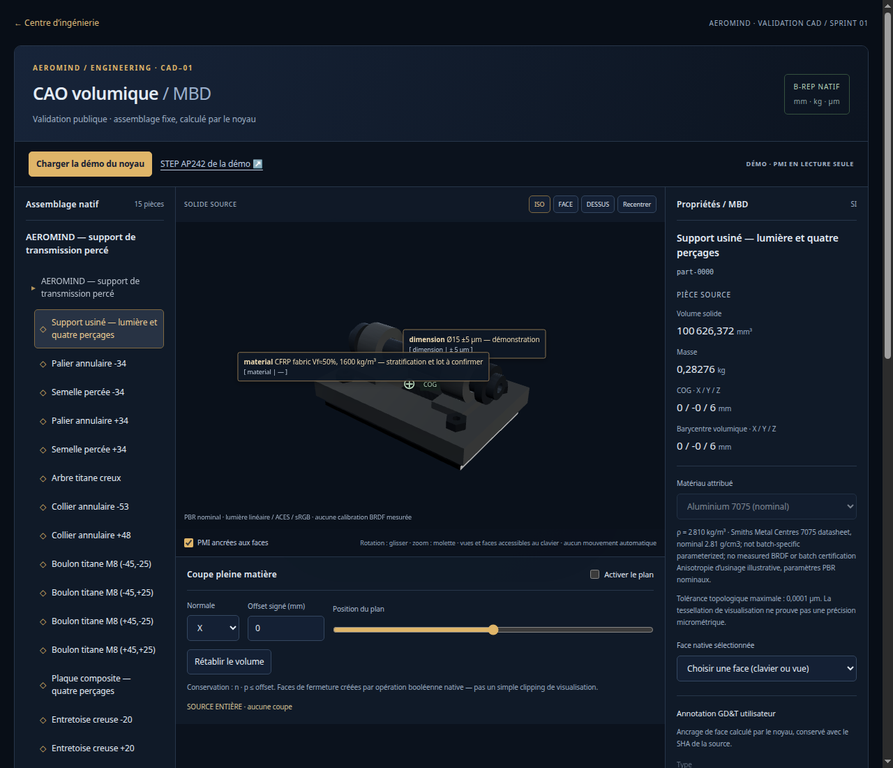
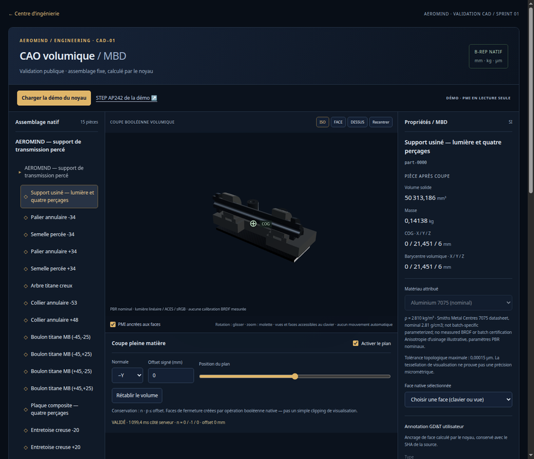

# Démonstration réelle — Sprint 1

Les deux captures ci-dessous proviennent du navigateur exécutant l’application compilée, avec un contexte WebGL 2 réellement disponible. Elles n’ont été ni générées ni retouchées. La source affichée correspond au SHA-256 du STEP téléchargeable contrôlé dans `http-demo.json`.

## Assemblage natif et PBR nominal

## Coupe longitudinale −Y, offset 0 mm

Le serveur indique un résultat **VALIDÉ** avec n = (0, −1, 0) et offset 0 mm. L’inspecteur affiche les propriétés du support coupé et les nouvelles faces de fermeture. Les PMI retirées par cette coupe restent dans le registre source mais ne sont pas réancrées à une autre face.

Les contrôles numériques X≤0, analytiques, annulaire et de placement sont consignés séparément dans `http-section.json`, `../../fixtures/cad/cad_evidence.json` depuis la racine projet et les suites de tests. Une capture ne constitue ni une calibration optique ni une preuve de conformité GD&T de fabrication.
